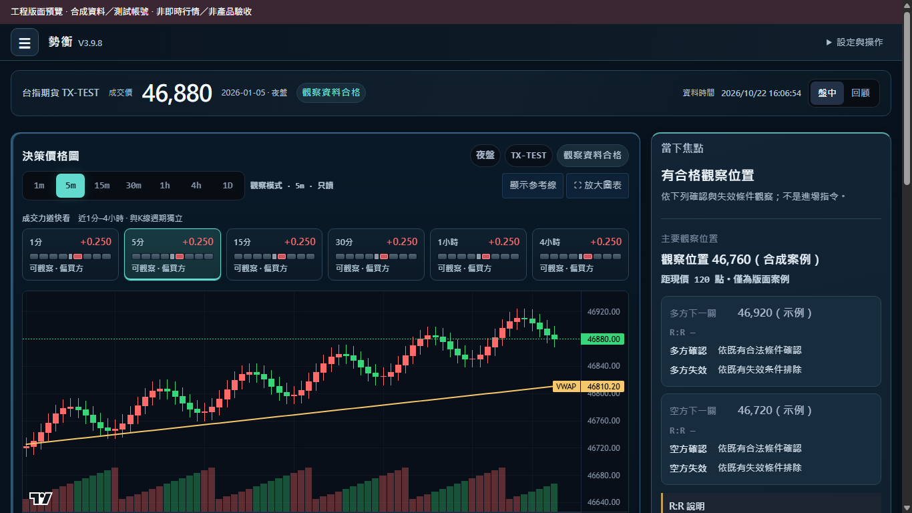
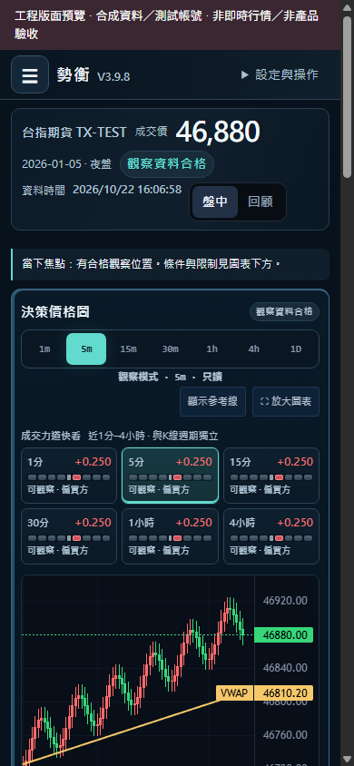
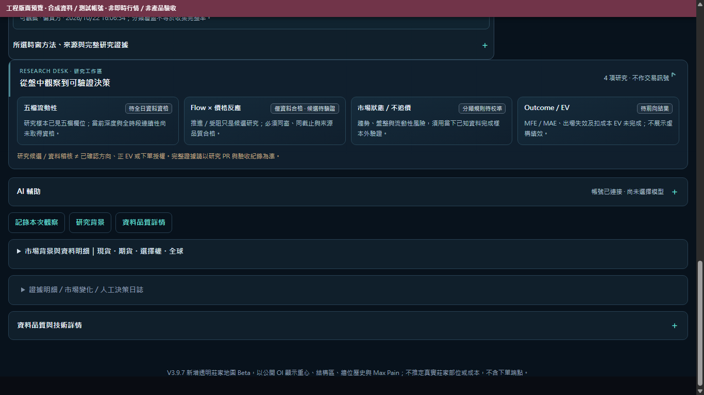
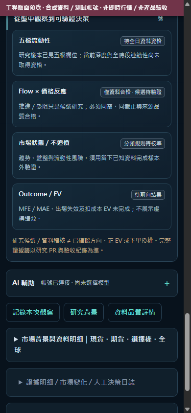

# CRU-21 UI Clarity P1｜Desktop / Mobile Reading Hierarchy

**Scope:** presentation-only experimental branch based on PR87 `cf3d179b0d6d7d1a3a778a24bc51bfed294db41d`. This is a Draft review candidate, not production deployment or trading permission. The original chart, six-window Flow tabs, UI selectors, user sessions, CSRF, model request controls and official Bridge/Producer are untouched.

## Why this change

Observed the actual production-CSS synthetic Chrome screenshots (baseline 1366×768 and iPhone-size 390×844) before editing. Initial phone layout used too much height in repeated market identity and chart context labels, pushing the candlestick chart below the first screen (starts near y=750px). The actual chart and the owner-approved six quick windows are the priority, not large decorative risk badges or an invented research score.

## Owner-centered reading order

1. **Contract/price and source trust** in a restrained dark market strip. Numeric price is primary; date/session, timestamp and mode remain visible.
2. **K-line toolbar and six Flow windows** in the left large chart region. The original native six independent Flow tabs and chart timeframe are preserved and continue to use the same governed rows and classification gates.
3. **Decision focus / next observable price conditions** in the right desktop rail, with clear boundaries that conditions are not trade instructions.
4. **Detailed Flow + Market context** remains in the existing secondary cards; quality and source caveats are not suppressed.
5. **Research Desk (collapsible, initially closed)** gives clear navigation of four future capabilities: L5 depth, Flow × Price Response, Market State/No-Chase, Outcome/EV. It explicitly says these are not currently live qualified signals. The only dynamic text is the selected, already governed Flow row's data qualification. The research desk NEVER calls new APIs or computes Depth, absorption, EV or trading direction.
6. AI assistant remains in the existing progressively disclosed panel; no auto-model/credit consent or service calls.

## Design system

- Calm deep navy backgrounds, layered blue-gray panels, restrained turquoise interactive accents; no neon wallpaper/no visual clutter.
- Price and observed direction shown with tabular numerals. Red/green directional color is still governed by the existing Flow qualified state; limited/unknown data is gray and labelled.
- Active Flow window outlined in cyan to distinguish interaction selection from buy/sell direction.
- Desktop: large price chart plus fixed-width reading rail; mobile: compact identity, no duplicate contract/session pills inside chart, 7 chart timeframe tabs fit without horizontal scrolling, six Flow tiles remain 3×2, candlestick chart height ≥ 319px.
- Native HTML `
/
` research disclosure supports keyboard and screen readers; `prefers-reduced-motion` disables decorative transitions.

## Verification

Real production HTML/CSS/actual chart factory in synthetic isolated Chrome was visually inspected at 1366 and 390. After refinement, phone chart begins near y=630 rather than y=750 in the same synthetic scenario. Automated Chrome tests check mobile/document horizontal overflow, all six quick tabs, 9-cell Flow directional meter, click/tab/expand restoration, consent/AI boundaries, data offline/warming/limited safeguards, disclosure keyboard access and four research cards.

Full repository CI and independently reviewed exact candidate HEAD are required before any merge; normal-auth Owner browser review and any production cutover require separate approval. No original source feed, data ledger, official 8787, order router or paid model request is modified or started.

**Explicit limitations:** L5 research code is in a separate Draft PR #90; this PR's research UI is a truthful progress/disclosure panel, not yet wired to the research backend. Presence of this section does not mean live No-Chase/EV states exist. Night cash-close source PR #89 also remains separately reviewed.

## Visual acceptance captures (isolated real Chrome, synthetic inputs)

All screenshots have the explicit synthetic preview ribbon; **not live TX or order evidence**. Native CSS/DOM and actual chart factory are used.

**Desktop 1366px / main workspace**

**Phone 390px / K-line visible on first screen**

**Research Desk expanded on desktop**

**Research Desk expanded on phone**

Expanded/collapsed research cards never call market APIs, AI endpoints or order routes. Snapshot image captures and UI assertions are test evidence only, not an Owner approval for merge/deployment.

## 2026-10-22 independent review P2 screenshot safety fix

The first scrolled Research Desk evidence images omitted the top-of-page synthetic ribbon. The browser test helper now injects a **fixed, always-visible, high-contrast** Chinese watermark on screenshots of scrolled research cards: `工程版面預覽 · 合成資料／測試帳號 · 非即時行情／非產品驗收`. The capture fails closed if the watermark is missing or not fixed and spanning the visible content width; the temporary banner is removed after capture and does **not** exist in the actual product. All four evidence PNG files were regenerated and independently visually checked after the fix. The L5 status copy now describes sampled historical evidence only, without claiming current live depth is verified.

Revised screenshots are synthetic engineering evidence, **never** Owner live-source or normal-auth acceptance. The first unwatermarked screenshots on an older commit must not be used as evidence.