# Phase B — F3 INCREMENTAL VALIDATION PROGRAM Master Plan

狀態：`OWNER REVIEW`。本文件只定義研究計畫；未授權執行模型、T0回測或任何Promotion。

## 1. 目的

使用經Owner批准且Hash凍結的T0作為H0 Baseline，逐一驗證F3候選是否具有可重播、成本後、跨Fold及跨Regime的增量價值。Phase B不是新因子搜尋，也不產生正式Signal或Paper資格。

## 2. 正式依賴

```mermaid
flowchart LR
  A["F3 Registry治理"] --> B["T0 Spec Freeze"]
  B --> C["T0 Data / Replay Gate"]
  C --> D["T0 Implementation"]
  D --> E["T0 H0 Acceptance"]
  E --> F["B0 Preregistration"]
  F --> G["B1 單候選增量"]
  G --> H["B2 產品角色測試"]
  H --> I["B3 穩定性與成本"]
  I --> J["B4 F4 Promotion Board"]
```

任一上游Gate未PASS，不得開始下游。每一階段完成後仍需Product Owner批准下一階段。

## 3. 分段規格

### B0 — Preregistration Freeze

輸入：T0 H0 Hash、F3 Candidate Hash、資料Snapshot Hash、Target定義、成本表版本。

輸出：每個候選的固定公式、角色、方向、Target、availableAt、拒絕條件、Fold、Regime、Seed與多重比較Family。

Gate：所有Hash與F3 Registry一致；Cohort A不可重挑；B／C順序不可因新結果改變。

### B1 — Individual Incremental Test

比較：`T0 only` 對 `T0 + 單一Candidate Evidence Block`。一次只加入一組，不混合候選、不新增Interaction。

輸出：成本後Expectancy、Profit Factor、Max Drawdown、勝率、盈虧比、MAE／MFE、False Breakout、Trade Retention及集中度差異。

Gate：增量必須具實質意義，且不是少數日期或單一Fold造成。

### B2 — Product Role Validation

分別驗證候選作為 `Direction`、`Risk Veto`、`Regime`、`Confirmation`、`NO_TRADE` 的預先登記用途。不得因某角色失敗就臨時改成另一角色；角色替代必須在B0預先列明。

Gate：主要角色失敗即按預先拒絕規則處理；不得用次要角色事後救援。

### B3 — Robustness and Cost

固定檢查：Base／2／3 ticks每側成本、Purged Walk-forward、年度與Regime、Long／Short、結算／換月、Tail、False Breakout、MAE／MFE、Trade Retention、極端日集中度、Placebo／Bootstrap及Holm修正。

Gate：任何資料洩漏、availableAt違規、Hash漂移或主要負控制失敗均停止該候選。

### B4 — F4 Promotion Board

唯一允許的最高輸出：

`F4_HISTORICAL_INCREMENTAL_CANDIDATE`、`evaluationStatus=PENDING`、`promotionEligible=false`。

不得直接進F5、F6、F7；新的Frozen Forward仍需獨立Owner授權。

## 4. 模型與研究限制

- 只使用透明、事前定義的比較；不得AutoML、神經網路、黑箱模型或超參數搜尋。
- 不新增Target、Feature、Window、Interaction或成本情境。
- 不因失敗調整T0、F3公式、門檻、Fold或Seed。
- 不將逐筆成交筆數當成獨立交易日樣本數。
- Reconciled契約敏感因子只讀取Phase A Reconciled View。
- Cohort A五項同時為Active上限；B／C只能按凍結順序且經Owner批准後遞補。

## 5. Acceptance與停止條件

| 階段 | PASS必要證據 | 立即停止條件 |
|---|---|---|
| B0 | 所有Spec／Data／Candidate／T0 Hash一致 | 任一Hash不一致或規格缺欄位 |
| B1 | 單候選、單資訊群、完整成本後比較 | 新增組合、Interaction或資料洩漏 |
| B2 | 預登記角色逐項報告，失敗結果保留 | 事後換角色或換Target |
| B3 | Walk-forward、Regime、負控制、多重比較完整 | 主要Gate失敗、結果由極端日主導 |
| B4 | 完整正反證、Scope Diff、可重建Promotion Board | 省略負面結果或嘗試升F5以上 |

## 6. 後續產品Roadmap順序

`T0 → Cash Flow State v0 → Futures Positioning State v0 → Options Structure State v0 → Daily Bias／Risk State → RISK-0 → Signal Contract v0 → Strategy Sandbox → Paper Trading → N0 Night Session Baseline → Cross-Session Position／Risk → RISK-1 → Shadow Live → Automated Execution重新決策`

Dealer Map、Flow Signal、Greeks／DEX／GEX及Dashboard改版不得插隊。

## 7. 現在的邊界

- T0 Implementation：未授權
- T0 Historical Run：未授權
- Phase B Model Execution：未授權
- F4 Promotion：未授權
- Frozen Forward：未授權
- formalWeight=0
- researchOnly=true
- executionAuthorized=false
